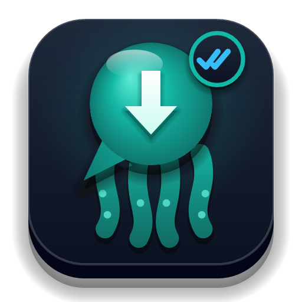
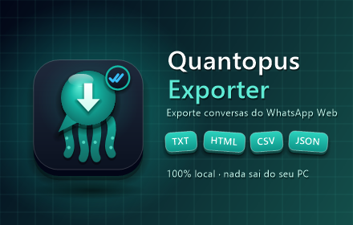
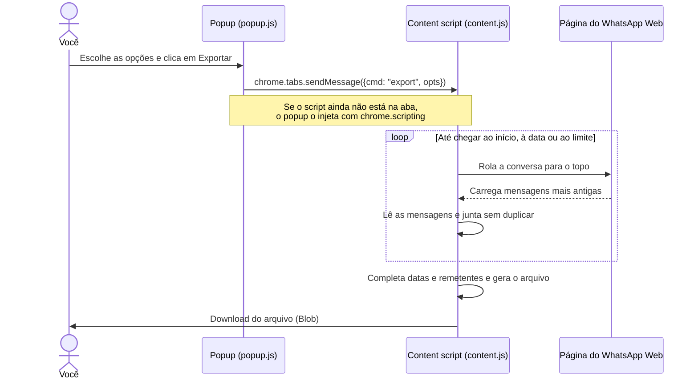

<p align="center">
  
</p>

<h1 align="center">Quantopus Exporter</h1>

<p align="center">
  <strong>Exporte conversas do WhatsApp Web para TXT, HTML, CSV ou JSON, direto do navegador e 100% local.</strong>
</p>

<p align="center">
  
  
  
  
</p>

<p align="center">
  
</p>

> **Aviso:** o Quantopus Exporter é um projeto independente. Ele não é afiliado, associado, autorizado ou endossado pelo WhatsApp LLC ou pela Meta Platforms, Inc. "WhatsApp" é marca de seus respectivos donos e aparece aqui só para indicar compatibilidade.

---

## Sumário

- [O que é](#o-que-é)
- [Principais recursos](#principais-recursos)
- [Instalação](#instalação)
- [Como usar](#como-usar)
- [Opções de exportação](#opções-de-exportação)
- [Formatos de saída](#formatos-de-saída)
- [Tipos de mensagem reconhecidos](#tipos-de-mensagem-reconhecidos)
- [Privacidade e segurança](#privacidade-e-segurança)
- [Ritmo de carregamento e cautela](#ritmo-de-carregamento-e-cautela)
- [Limitações conhecidas](#limitações-conhecidas)
- [Solução de problemas](#solução-de-problemas)
- [Como funciona por dentro](#como-funciona-por-dentro)
- [Desenvolvimento](#desenvolvimento)
- [Publicação nas lojas](#publicação-nas-lojas)
- [Ideias para próximas versões](#ideias-para-próximas-versões)
- [Contribuindo](#contribuindo)
- [Licença](#licença)

---

## O que é

O **Quantopus Exporter** é uma extensão para Google Chrome e Microsoft Edge que salva em arquivo a conversa aberta no [WhatsApp Web](https://web.whatsapp.com), seja individual ou de grupo.

O celular já tem o "Exportar conversa", mas ele só gera um `.txt` e precisa ser enviado para algum lugar. O Quantopus Exporter faz isso no computador, em quatro formatos, e com controle sobre o que entra no arquivo:

- **Quanto do histórico:** a conversa inteira, só a partir de uma data ou só as N mensagens mais recentes.
- **Em que formato:** texto simples, página para leitura e impressão, planilha ou dados estruturados.
- **Sem servidor:** nada sai do seu computador. A extensão não tem servidor, analytics nem código remoto.

Alguns usos:

- Guardar o histórico de atendimento de clientes ou pacientes, conforme a sua política de retenção e a LGPD.
- Juntar conversas como registro para processos, auditorias ou perícias.
- Analisar conversas em Excel, Google Planilhas, Python ou Power BI.
- Fazer backup legível de conversas importantes antes de trocar de celular.

---

## Principais recursos

| | Recurso | Detalhe |
|---|---|---|
| 📄 | **4 formatos** | TXT, HTML, CSV e JSON |
| 🐙 | **Todas as conversas de uma vez** | Abre e exporta cada conversa da lista, **salvando cada uma na hora** numa pasta nomeada pelo número |
| 📇 | **Número no nome** | Os arquivos levam o número do contato (ex.: `+5511999999999`), além do nome |
| 📜 | **Histórico completo** | Rola a conversa até o início e carrega as mensagens antigas automaticamente |
| 📅 | **Filtro por data** | Exporta só as mensagens a partir de um dia escolhido |
| 🔢 | **Limite de mensagens** | Exporta só as N mensagens mais recentes |
| 😀 | **Emojis preservados** | Os emojis (que o WhatsApp mostra como imagem) viram caracteres de verdade |
| ↩️ | **Respostas (citações)** | Registra a mensagem que foi respondida |
| 🖼️ | **Mídias identificadas** | Fotos, vídeos, áudios, documentos, figurinhas, contatos, localizações e mensagens apagadas aparecem marcados, com a legenda quando houver |
| 👥 | **Grupos** | Registra o nome de cada participante |
| ⏸️ | **Parar a qualquer momento** | Um botão interrompe a rolagem e exporta o que já foi carregado |
| 🐢 | **Ritmo cuidadoso** | Intervalo entre rolagens e pausas automáticas |
| 🔒 | **100% local** | Nenhum dado sai do navegador |
| 🌗 | **HTML com tema claro e escuro** | O arquivo HTML segue o tema do sistema |
| 🇧🇷 | **CSV pronto para o Excel em português** | Separador `;` e UTF-8 com BOM, para os acentos abrirem certos |

---

## Instalação

### Pela loja (em breve)

Quando a extensão estiver publicada na Chrome Web Store e na Microsoft Edge Add-ons, os links vão aparecer aqui.

### Modo desenvolvedor (a partir deste repositório)

1. Baixe o código:
   - **Code → Download ZIP** e extraia, **ou**
   - clone o repositório:
     ```bash
     git clone https://github.com/engcarlo/quantopus-exporter.git
     ```
2. Abra `chrome://extensions` no Chrome (ou `edge://extensions` no Edge).
3. Ative o **Modo do desenvolvedor**, no canto superior direito.
4. Clique em **Carregar sem compactação** e selecione a pasta do projeto (a que contém o `manifest.json`).
5. Opcional: clique no ícone de quebra-cabeça 🧩 da barra e fixe o **Quantopus Exporter**.

> Se o WhatsApp Web já estava aberto antes da instalação, não precisa recarregar: a extensão se ativa sozinha na aba quando você abre o popup.

**Para atualizar:** baixe a versão nova (ou rode `git pull`), abra `chrome://extensions` e clique em ↻ no card da extensão.

---

## Como usar

1. Abra o [WhatsApp Web](https://web.whatsapp.com) e clique na conversa que quer exportar.
2. Clique no ícone do **Quantopus Exporter** na barra do navegador.
3. O popup mostra o nome da conversa aberta. Escolha:
   - o **formato** do arquivo;
   - se quer **carregar todo o histórico**;
   - o **ritmo** de carregamento;
   - opcionalmente, **a partir de qual data** e o **máximo de mensagens**.
4. Clique em **Exportar**. Você pode fechar o popup: a exportação continua na página.
5. Um painel no canto inferior direito do WhatsApp mostra o progresso:
   - `Carregando histórico… 1.240 mensagens`
   - `Pausa curta (15 s)… 2.500 mensagens até agora`
6. No fim, o arquivo é **salvo em segundo plano**, sem janela de "Salvar como", em
   `<pasta escolhida>/<subpasta>/<número>/WhatsApp - <número> - <nome da conversa> - <AAAA-MM-DD>.<formato>`.
   Em grupos, a pasta e o nome começam com `Grupo - …`. Se o número não estiver disponível (veja [Limitações](#limitações-conhecidas)), a pasta fica `Sem número - <nome>`.

### Pasta de salvamento

Na **primeira exportação**, o painel no canto do WhatsApp pergunta onde salvar:

| Botão | O que faz |
|---|---|
| **Escolher pasta…** | Abre a janela do sistema para escolher **qualquer pasta do computador**, inclusive em outro disco. Isso acontece só uma vez; depois, tudo é gravado em segundo plano. |
| **Usar a pasta "…"** | Reaproveita a pasta escolhida antes. O Chrome pede para reautorizar uma vez por sessão do navegador, com um clique. |
| **Usar a pasta Downloads** | Salva dentro da pasta de Downloads do Chrome. |

- O campo **Subpasta de salvamento** do popup (padrão `Quantopus Exporter`) cria uma subpasta dentro da pasta escolhida. Deixe vazio para salvar direto nela, ou use `/` para níveis, por exemplo `Clientes/2026`.
- Arquivos existentes **não são sobrescritos**: se o nome já existir, o novo vira `… (2).txt`.
- Na opção **Downloads**, se o Chrome estiver com **"Perguntar onde salvar cada arquivo"** ligado, ele abre a janela de salvar a cada arquivo. Prefira **Escolher pasta…**, ou desligue essa opção em `chrome://settings/downloads`.
- O Chrome não deixa escolher algumas pastas do sistema (como `C:\`, `C:\Windows` ou a raiz da pasta do usuário). Nesses casos, crie ou escolha uma subpasta.

O número do contato é lido no painel **Dados do contato**, que a extensão abre e fecha sozinha em cada conversa. Isso leva cerca de 1 a 3 s e não altera nada na conversa.

> **Parar e exportar o que já carregou:** esse botão do painel interrompe a rolagem e gera o arquivo na hora, com o que já foi lido.

> **Não troque de conversa durante a exportação.** Se trocar, a extensão percebe e cancela, para não misturar mensagens de conversas diferentes.

### Exportar todas as conversas

1. No popup, escolha **Todas as conversas**. Não precisa ter nenhuma conversa aberta.
2. Ajuste as opções extras:
   - **Pular conversas com mensagens não lidas** (ligado por padrão): abrir uma conversa a marca como lida, então essas ficam de fora;
   - **Incluir grupos**;
   - **Máximo de conversas** (opcional).
3. Clique em **Exportar todas**. A extensão vai, de cima para baixo na lista:
   1. abrir a conversa;
   2. exportar com as mesmas opções de formato, histórico, data e limite;
   3. **salvar o arquivo na hora**, na pasta de salvamento, numa subpasta com o número;
   4. esperar alguns segundos e seguir para a próxima. A cada 10 conversas, faz uma pausa de 30 s.
4. No fim, salva também um **índice** da execução. O resultado fica assim:

```text
<pasta escolhida>/Quantopus Exporter/
├── +5511999999999/
│   └── WhatsApp - +5511999999999 - Ana - 2026-11-12.txt
├── +5521988887777/
│   └── WhatsApp - +5521988887777 - Dr. Paulo - 2026-11-12.txt
├── Grupo - Equipe Clínica/
│   └── WhatsApp - Grupo - Equipe Clínica - 2026-11-12.txt
├── Sem número - Fornecedor X/
│   └── WhatsApp - Fornecedor X - 2026-11-12.txt
└── indice 2026-11-12 14-30.csv
```

Como cada conversa é gravada assim que termina, nada se perde se o processo for interrompido no meio: o que já foi exportado já está no disco.

- Cada conversa fica em **sua própria pasta, com o número como nome**.
- Grupos ficam em `Grupo - <nome>`.
- Contatos cujo número o WhatsApp não mostra ficam em `Sem número - <nome>`.
- O **índice** (`indice <data> <hora>.csv`) lista todas as conversas encontradas, com número, se é grupo, quantidade de mensagens, caminho do arquivo e status: `ok`, `parcial`, `pulada: mensagens não lidas`, `pulada: grupo`, `sem mensagens` ou `erro: …`.

> **Parar e salvar o que já exportou:** interrompe o processo. A conversa em andamento é salva como `parcial`, e o índice é gravado.

> **Dica:** para muitas conversas, desligue **Carregar todo o histórico** (exporta só as mensagens recentes de cada uma) ou use **Somente a partir de** para limitar o período. Com o histórico completo, o processo pode levar horas.

> **Durante a exportação, não use o WhatsApp nessa aba:** clicar em outra conversa atrapalha o processo. Você pode usar outras abas e programas normalmente.

---

## Opções de exportação

| Opção | Valores | O que faz |
|---|---|---|
| **O que exportar** | Conversa aberta / Todas as conversas | Exporta só a conversa aberta ou percorre a lista inteira, salvando cada conversa na hora. Veja [Exportar todas as conversas](#exportar-todas-as-conversas). |
| **Pular não lidas** *(todas)* | ligado / desligado | Não abre conversas com mensagens não lidas, para não marcá-las como lidas. |
| **Incluir grupos** *(todas)* | ligado / desligado | Inclui ou não os grupos na exportação. |
| **Máximo de conversas** *(todas)* | número (opcional) | Para depois de exportar essa quantidade de conversas, de cima para baixo na lista. |
| **Subpasta de salvamento** | texto | Subpasta criada dentro da pasta escolhida (ou de Downloads). Veja [Pasta de salvamento](#pasta-de-salvamento). |
| **Formato** | TXT, HTML, CSV, JSON | Tipo do arquivo gerado. Veja [Formatos de saída](#formatos-de-saída). A extensão lembra a última escolha. |
| **Carregar todo o histórico** | ligado / desligado | **Ligado:** rola a conversa até o início, carregando as mensagens antigas. **Desligado:** exporta só o que já está carregado na tela. |
| **Ritmo de carregamento** | Normal (2 s) / Cauteloso (3 s) | Tempo de espera entre uma rolagem e a próxima. A cada 50 rolagens há uma pausa de 15 s. A extensão lembra a escolha. |
| **Somente a partir de** | data (opcional) | A rolagem para ao chegar antes dessa data, e o arquivo só tem mensagens desse dia em diante. |
| **Máximo de mensagens** | número (opcional) | A rolagem para ao atingir esse número, e o arquivo fica só com as **mais recentes**. |

As opções combinam entre si. Por exemplo: "a partir de 01/01/2026, no máximo 500 mensagens, em CSV".

**Como a extensão sabe que chegou ao início da conversa:** quando passam cerca de 10 segundos sem nenhuma mensagem nova carregar, ela conclui que acabou e gera o arquivo.

---

## Formatos de saída

### TXT: parecido com a exportação do celular

Ideal para leitura rápida, arquivamento ou para colar em outro lugar.

```text
Conversa: Ana
Número: +5511999999999
Exportada em: 12/11/2026, 09:41:07
Mensagens: 4

05/11/2026 14:32 - Ana: Bom dia! Posso remarcar para quinta? 😊
05/11/2026 14:35 - Recepção: Claro, quinta às 10h fica bom?
05/11/2026 14:36 - Ana: [respondendo a: "Claro, quinta às 10h fica bom?"] Perfeito, obrigada!
05/11/2026 14:37 - Ana: <documento> exame_sangue.pdf
```

### HTML: visual de chat, pronto para ler e imprimir

- Balões à direita (você) e à esquerda (outros), com o nome do remetente.
- Separadores de data entre os dias.
- Citações destacadas e marcadores de mídia.
- Tema claro ou escuro, de acordo com o sistema.
- Um único arquivo, sem dependências: abre em qualquer navegador, inclusive offline, e dá para salvar em PDF com **Ctrl+P → Salvar como PDF**.

### CSV: para Excel e Google Planilhas

Separador `;`, campos entre aspas e UTF-8 com BOM, para abrir direto no Excel em português com os acentos certos.

```text
data;hora;remetente;enviada_por_mim;tipo;texto;citacao
"05/11/2026";"14:32";"Ana";"nao";"texto";"Bom dia! Posso remarcar para quinta? 😊";""
"05/11/2026";"14:35";"Recepção";"sim";"texto";"Claro, quinta às 10h fica bom?";""
"05/11/2026";"14:37";"Ana";"nao";"documento";"exame_sangue.pdf";""
```

| Coluna | Conteúdo |
|---|---|
| `data` | Data como o WhatsApp mostra (ex.: `05/11/2026`) |
| `hora` | Hora da mensagem (ex.: `14:32`) |
| `remetente` | Nome ou número de quem enviou |
| `enviada_por_mim` | `sim` ou `nao` |
| `tipo` | Veja [Tipos de mensagem](#tipos-de-mensagem-reconhecidos) |
| `texto` | Texto da mensagem ou legenda da mídia |
| `citacao` | Texto da mensagem respondida, se houver |

### JSON: dados estruturados

Para integrar com outros sistemas, rodar análises em Python ou JavaScript ou importar em um banco de dados.

```json
{
  "chat": "Ana",
  "number": "+5511999999999",
  "isGroup": false,
  "exportedAt": "12/11/2026, 09:41:07",
  "total": 2,
  "messages": [
    {
      "id": "false_5511999999999@c.us_3EB0A1B2C3D4",
      "fromMe": false,
      "date": "05/11/2026",
      "time": "14:32",
      "sender": "Ana",
      "type": "texto",
      "text": "Bom dia! Posso remarcar para quinta? 😊"
    },
    {
      "id": "true_5511999999999@c.us_3EB0E5F6A7B8",
      "fromMe": true,
      "date": "05/11/2026",
      "time": "14:35",
      "sender": "Recepção",
      "type": "texto",
      "text": "Claro, quinta às 10h fica bom?",
      "quote": "Bom dia! Posso remarcar para quinta?"
    }
  ]
}
```

| Campo | Tipo | Descrição |
|---|---|---|
| `id` | string | Identificador interno da mensagem no WhatsApp Web |
| `fromMe` | boolean | `true` se você enviou |
| `date` / `time` | string | Data e hora como o WhatsApp mostra |
| `sender` | string | Remetente |
| `type` | string | Tipo da mensagem |
| `text` | string | Texto ou legenda |
| `quote` | string? | Mensagem citada (só aparece quando existe) |

---

## Tipos de mensagem reconhecidos

| `tipo` | Marcador no TXT | O que é exportado |
|---|---|---|
| `texto` | (nenhum) | O texto completo, com emojis e quebras de linha |
| `imagem` | `<imagem>` | O marcador e a legenda, se houver |
| `video` | `<vídeo>` | O marcador e a legenda, se houver |
| `audio` | `<áudio>` | O marcador (áudios e mensagens de voz) |
| `documento` | `<documento>` | O marcador e o nome ou legenda |
| `sticker` | `<figurinha>` | O marcador |
| `contato` | `<contato>` | O marcador |
| `localizacao` | `<localização>` | O marcador |
| `apagada` | `<mensagem apagada>` | O marcador |
| `sistema` | (linha sem remetente) | Avisos do WhatsApp: "fulano entrou no grupo", criptografia etc. |

> O arquivo de mídia em si (a foto, o vídeo, o áudio) **não** é baixado. Veja [Limitações](#limitações-conhecidas).

---

## Privacidade e segurança

**Tudo acontece no seu navegador.** A extensão:

- ❌ não tem servidor;
- ❌ não envia mensagens nem dados para lugar nenhum;
- ❌ não usa analytics, anúncios ou rastreamento;
- ❌ não carrega código remoto (todo o código está neste repositório);
- ❌ não usa as funções internas do WhatsApp: ela só **lê a página**, como você faria lendo a tela;
- ✅ guarda só suas preferências (formato e ritmo) no armazenamento local do navegador.

### Permissões pedidas

| Permissão | Por quê |
|---|---|
| Acesso a `https://web.whatsapp.com/*` | Ler a conversa aberta para gerar o arquivo. Nenhum outro site é acessado. |
| `scripting` | Ativar a extensão numa aba do WhatsApp Web que já estava aberta antes da instalação, sem precisar recarregar. |
| `downloads` | Salvar em Downloads, quando você escolhe essa opção em vez de uma pasta do computador. |

A política de privacidade completa está em [`docs/privacy-policy.html`](docs/privacy-policy.html).

> ⚠️ **Cuidado com os arquivos exportados.** Eles podem ter dados pessoais seus e de outras pessoas. Guarde e compartilhe com responsabilidade, de acordo com a LGPD. Nunca faça commit de exportações reais em repositórios: o `.gitignore` deste projeto já ignora arquivos `WhatsApp - *`.

---

## Ritmo de carregamento e cautela

A extensão **não envia mensagens** nem usa as funções internas do WhatsApp. Ela só rola a conversa para cima, como você faria com a roda do mouse, então o risco para a sua conta é baixo. Mesmo assim, ela foi feita para não puxar o histórico de forma agressiva:

- espera **pelo menos 1,5 s** entre as rolagens: 2 s no modo Normal e 3 s no Cauteloso;
- faz uma **pausa de 15 s a cada 50 rolagens**;
- permite **limitar por data ou por número** de mensagens;
- faz **uma exportação por vez** em cada aba.

**Recomendação:** evite exportar dezenas de conversas longas em sequência. Para conversas com anos de histórico, prefira o modo **Cauteloso** ou o filtro por data.

> O Quantopus Exporter **não** é e nunca será uma ferramenta de envio de mensagens em massa. Para enviar mensagens em volume, use a [WhatsApp Business Platform](https://business.whatsapp.com/products/business-platform) oficial.

---

## Limitações conhecidas

- **As mídias não são baixadas.** Fotos, vídeos, áudios e documentos aparecem como marcadores, com a legenda quando houver.
- **O histórico depende do celular.** O WhatsApp Web só carrega o que o celular sincronizou. Mensagens muito antigas podem não aparecer.
- **Mídias sem legenda** não têm data nem remetente visíveis na página. A extensão herda esses dados da mensagem vizinha. Em grupos, o remetente pode aparecer como `?`.
- **Formato de data:** a data é exportada como o WhatsApp mostra, que depende do idioma configurado (ex.: `05/11/2026` em português, `11/5/2026` em inglês dos EUA).
- **Mudanças no WhatsApp Web:** a extensão lê a estrutura da página. Se o WhatsApp mudar o layout, a leitura pode falhar até a extensão ser atualizada. Veja [Como funciona por dentro](#como-funciona-por-dentro).
- **Número do contato:** o número é lido no painel **Dados do contato** ou, em contatos não salvos, no próprio título da conversa. Se o WhatsApp não mostrar o número ali (alguns perfis o escondem), a conversa é salva pelo nome (`Sem número - <nome>`).
- **Quem enviou cada mensagem:** nas versões atuais do WhatsApp Web, essa informação vem da aparência da bolha (lado e status de entrega). Em mensagens de sistema ou formatos incomuns, ela pode sair trocada.
- **Exportar todas marca como lidas:** abrir uma conversa envia a confirmação de leitura, como se você a abrisse manualmente. Use a opção **Pular conversas com mensagens não lidas** para evitar isso.
- **Conversas arquivadas** não entram na exportação de todas as conversas, só as da lista principal.
- **Conversas com o mesmo nome:** na exportação de todas, a lista é percorrida pelo nome exibido. Dois contatos salvos com exatamente o mesmo nome podem fazer um deles ser pulado.
- **Navegadores:** testada para Chrome e Edge (Chromium). Firefox e Safari ainda não são suportados.

---

## Solução de problemas

| Problema | O que fazer |
|---|---|
| **"Abra o WhatsApp Web nesta aba…"** | O popup foi aberto em outra aba. Vá para a aba do `web.whatsapp.com` e abra o popup de novo. |
| **"Clique em uma conversa no WhatsApp Web…"** | Nenhuma conversa está aberta. Clique em uma conversa da lista e abra o popup de novo. |
| **"Não consegui acessar a página. Recarregue…"** | Recarregue o WhatsApp Web (F5) e tente de novo. |
| **"Não encontrei a área de mensagens da conversa."** | O layout do WhatsApp pode ter mudado. Abra uma *issue* informando a versão do navegador. |
| **"Nenhuma mensagem encontrada."** | Pode ser uma conversa vazia ou um filtro de data muito restritivo. Também pode indicar mudança no layout do WhatsApp. |
| **"A conversa foi trocada durante a exportação."** | Você mudou de conversa no meio do processo. Exporte de novo sem trocar de conversa. |
| **O arquivo não foi baixado** | Veja se o navegador bloqueou downloads automáticos de `web.whatsapp.com` (ícone na barra de endereço) e permita. |
| **CSV com acentos estranhos** | Abra o arquivo direto no Excel com duplo clique. Se usar **Dados → De texto/CSV**, escolha a codificação **UTF-8** e o delimitador **ponto e vírgula**. |
| **Exportação muito lenta** | É esperado em conversas longas por causa do ritmo de segurança. Use o filtro de data ou o limite de mensagens. |

---

## Como funciona por dentro



### Leitura das mensagens

Cada mensagem do WhatsApp Web fica num elemento com o atributo `data-id`:

- `data-id` começando com `true_` → mensagem **enviada por você**; com `false_` → **recebida**.
- `data-id` contendo `@g.us` → mensagem de **grupo**.
- O atributo `data-pre-plain-text` (ex.: `[14:32, 05/11/2026] Ana: `) traz **hora, data e remetente**.
- O texto vem dos elementos `span.selectable-text`. Emojis (``) viram o próprio caractere, e `<br>` vira quebra de linha.
- O tipo de mídia é identificado pelos ícones da página (`data-icon`) e por elementos `<audio>`, `<video>` e ``.

### Ordem e duplicatas

Durante a rolagem, cada leitura mostra só uma parte da conversa. A extensão guarda as mensagens num `Map` indexado pelo `data-id` e mantém uma lista de ordem. As mensagens novas que aparecem **antes** da primeira já conhecida entram no começo da lista. Assim a ordem cronológica se mantém e nada se repete.

### Se o WhatsApp mudar o layout

Os pontos que dependem da estrutura da página estão concentrados em [`content.js`](content.js):

| Função | O que ajustar |
|---|---|
| `getChatName()` | Seletor do nome da conversa no cabeçalho (`#main header`) |
| `findScroller()` | Como achar a área de mensagens que rola |
| `parseVisible()` / `parseRow()` | Seletores de mensagem (`div[data-id]`, `[data-pre-plain-text]`, `span.selectable-text`) |
| `detectType()` | Ícones usados para identificar o tipo de mídia |
| `clickLoadOlder()` | Texto do botão "carregar mensagens mais antigas" |
| `listChats()` / `openChat()` | Itens da lista de conversas (`#pane-side`, `[role="listitem"]`) e como abri-los |
| `chatIdentity()` | Como o número e o tipo (grupo ou individual) são extraídos do `data-id` |

---

## Desenvolvimento

O projeto **não tem dependências nem etapa de build** para rodar: é HTML, CSS e JavaScript puro (Manifest V3). Os scripts de apoio são em PowerShell e rodam no Windows sem instalar nada.

### Estrutura

```
quantopus-exporter/
├── manifest.json            configuração da extensão (MV3)
├── background.js            grava os arquivos na pasta de salvamento (chrome.downloads)
├── content.js               leitura das mensagens, rolagem, geração e download do arquivo
├── content.css              painel de progresso exibido no WhatsApp Web
├── popup.html / popup.js    janela de opções da extensão
├── icons/                   ícones 16, 48 e 128 px
├── scripts/
│   ├── make-images.ps1      gera os ícones, o logo 512 px e a imagem promocional (3D)
│   └── build.ps1            gera o .zip para as lojas em dist/
├── store/
│   ├── listing.md           textos prontos para a página da loja
│   ├── logo-512.png         logo em alta resolução
│   └── promo-440x280.png    imagem promocional da Chrome Web Store
├── docs/
│   └── privacy-policy.html  política de privacidade (publicada via GitHub Pages)
├── LICENSE
└── README.md
```

### Fluxo de trabalho

1. Carregue a pasta em `chrome://extensions` (modo desenvolvedor).
2. Edite os arquivos.
3. Clique em ↻ no card da extensão e recarregue a aba do WhatsApp Web.
4. Para depurar:
   - **content script:** DevTools da aba do WhatsApp (F12) → Console;
   - **popup:** clique com o botão direito no ícone da extensão → **Inspecionar pop-up**.

### Gerar as imagens

```bash
powershell -ExecutionPolicy Bypass -File scripts\make-images.ps1
```

Gera `icons/16.png`, `icons/48.png`, `icons/128.png`, `store/logo-512.png` e `store/promo-440x280.png`. As cores e o desenho ficam no início do script.

### Gerar o pacote

```bash
powershell -ExecutionPolicy Bypass -File scripts\build.ps1
```

Gera `dist/quantopus-exporter-<versão>.zip`, com só os arquivos da extensão e o `manifest.json` na raiz, que é o formato que as lojas aceitam. A pasta `dist/` é ignorada pelo git.

### Versão

Siga o [versionamento semântico](https://semver.org/lang/pt-BR/) no campo `"version"` do `manifest.json`:
- `1.0.1`: correção de bug, como um seletor quebrado por mudança do WhatsApp;
- `1.1.0`: recurso novo e compatível;
- `2.0.0`: mudança que quebra compatibilidade, como um formato de saída diferente.

As lojas exigem uma versão maior a cada envio.

---

## Publicação nas lojas

1. Aumente a `"version"` no `manifest.json`.
2. Gere o pacote com `scripts\build.ps1`.
3. Envie o `.zip`:
   - **Chrome Web Store:** [painel do desenvolvedor](https://chrome.google.com/webstore/devconsole) (taxa única de US$ 5);
   - **Microsoft Edge Add-ons:** [Partner Center](https://partner.microsoft.com/dashboard/microsoftedge) (gratuito).
4. Preencha a página da loja com os textos de [`store/listing.md`](store/listing.md): descrição, justificativa das permissões e respostas de privacidade.
5. Imagens: ícone `icons/128.png`, imagem promocional `store/promo-440x280.png` e de 1 a 5 capturas de tela em 1280×800, feitas com uma conversa de teste.

### Política de privacidade via GitHub Pages

1. No repositório, abra **Settings → Pages**.
2. Em **Build and deployment**, escolha **Deploy from a branch**, branch `main`, pasta `/docs`.
3. Em alguns minutos a política estará em
   `https://engcarlo.github.io/quantopus-exporter/privacy-policy.html`.

---

## Ideias para próximas versões

- [ ] Exportar para **PDF** direto
- [ ] Baixar as **mídias** (fotos, áudios, documentos) num `.zip` junto com a conversa
- [x] Exportar **todas as conversas** em sequência, com uma pasta por número (v1.1.0)
- [x] Salvar direto no disco, numa pasta definida antes de exportar (v1.2.0), em segundo plano em qualquer pasta (v1.3.0)
- [ ] Incluir **conversas arquivadas** na exportação de todas
- [ ] Filtro por **intervalo de datas** (de / até)
- [ ] Datas em **formato ISO** (`AAAA-MM-DD`) como opção
- [ ] Interface em **inglês e espanhol**
- [ ] Versão para **Firefox**

Sugestões são bem-vindas: abra uma *issue*.

---

## Contribuindo

1. Faça um *fork* do repositório.
2. Crie uma branch: `git checkout -b minha-melhoria`.
3. Teste no WhatsApp Web com uma **conversa de teste**, sem dados reais.
4. Faça o commit e abra um *Pull Request* descrevendo o que mudou e como testou.

Ao relatar um problema, informe a versão do navegador, a versão da extensão, o formato escolhido e a mensagem de erro do painel. **Nunca anexe conversas reais.**

---

## Licença

Distribuído sob a licença [MIT](LICENSE). Você pode usar, modificar e distribuir, mantendo o aviso de copyright.
